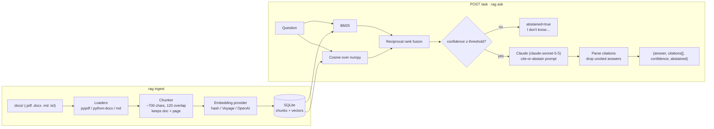

# docs-rag-assistant

A small, working **RAG knowledge assistant** over PDF / DOCX / Markdown documents:
hybrid retrieval (BM25 + vectors), Claude-generated answers with **page-level citations**
(`[refund_policy.pdf p.2]`), an explicit **"I don't know"** path when the documents do not
contain the answer, a FastAPI backend, and an **offline evaluation harness** against a
labelled question set. Built as a portfolio demo: the full pipeline is here and tested, but
the corpus is three short fictional documents and the defaults favour clarity over scale.
See [What I'd change for production](#what-id-change-for-production) for the honest list.

## Architecture



**How it addresses the usual complaints**

| Pain | What this does |
|---|---|
| "Uploaded PDFs sometimes aren't found" | Every chunk carries `doc` + `page`; `GET /health` reports chunk counts; the index refuses to serve if it was built with a different embedding provider than the one configured. |
| "Answers are generic" | The prompt forbids outside knowledge; an answer with no `[doc p.N]` citation is rejected and reported as abstained rather than returned. |
| "Inconsistent across paraphrases" | Hybrid BM25 + vector retrieval fused with RRF, plus light stemming (`retried`/`retries`), so lexical and semantic misses cover each other. |
| "Need page-level citations" | Citations resolve back to the stored chunk, returning `doc`, `page` and a snippet. |
| "Should say I don't know" | Two gates: a retrieval-confidence threshold (IDF-weighted term coverage + cosine) before calling the model, and the model's own abstain phrase after. |

## Quickstart

Requires Python 3.12 and [uv](https://docs.astral.sh/uv/).

```bash
git clone <this repo> && cd docs-rag-assistant
uv sync
cp .env.example .env            # add ANTHROPIC_API_KEY for real answers; optional

uv run rag ingest               # builds data/index.sqlite from docs/
uv run rag ask "How many days of PTO do employees get?"
uv run rag ask "Who is the CEO?"         # -> abstains
uv run python -m rag.eval       # prints the metrics table below
uv run rag serve                # FastAPI on http://127.0.0.1:8000/docs
```

API:

```bash
curl -X POST localhost:8000/ingest
curl -X POST localhost:8000/ask -H 'content-type: application/json' \
     -d '{"question": "What is the API rate limit on the Team plan?"}'
# {"answer": "... 600 requests per minute ... [product_faq.docx p.3].",
#  "citations": [{"doc": "product_faq.docx", "page": 3, "snippet": "..."}],
#  "confidence": 0.70, "abstained": false}
```

Without `ANTHROPIC_API_KEY` the service falls back to an extractive stand-in LLM that quotes
the best-matching sentence with its citation, so the API, CLI, tests and eval all run offline.
Embeddings default to a deterministic hashing embedder; set `RAG_EMBEDDING_PROVIDER=voyage`
or `openai` (with the matching key) for real semantic vectors.

Sample corpus (`docs/`, all fictional, regenerate with `uv run python scripts/make_sample_docs.py`):
`employee_handbook.md`, `product_faq.docx`, `refund_policy.pdf` (3 pages).

## Evaluation

`evals/questions.jsonl` has 17 labelled questions: 14 answerable (with expected document,
page and answer keywords, several phrased differently from the source text) and 3 unanswerable.
`uv run python -m rag.eval` rebuilds the index and reports:

| Metric | Offline (hash embeddings, extractive stand-in LLM) |
|---|---|
| Retrieval hit@5 (expected doc + page in top 5) | **100%** (14/14) |
| Citation accuracy (answered questions citing the expected page) | **93%** (13/14) |
| Keyword accuracy (answer contains the labelled facts) | **86%** (12/14) |
| Unanswerable questions abstained | **100%** (3/3) |
| Answerable questions wrongly abstained | **0%** (0/14) |

The two misses are the stand-in LLM picking a plausible sentence from the wrong page
(`refund-window`) and quoting the sentence without the labelled number (`rate-limit-team`);
with Claude answering, those are the model's job. The numbers above are what you get with
zero API keys; re-run with a key to measure the real model. The abstention margin is thin on
the hash embedder (the "Who is the CEO?" question scores 0.29 against a 0.30 threshold because
the company name appears everywhere), which is exactly why a real embedding provider is the
first production change.

## Project layout

```
rag/
  ingest.py      loaders + overlap chunking (doc, page kept per chunk)
  embeddings.py  hash / Voyage / OpenAI providers behind one Protocol
  store.py       SQLite chunk store + numpy cosine search
  retrieval.py   BM25 + vector, RRF fusion, confidence score
  answer.py      cite-or-abstain prompt, Claude client, citation parsing
  service.py     wiring; build_index(), RagService.ask()
  api.py         FastAPI: POST /ingest, POST /ask, GET /health
  cli.py         rag ingest | ask | serve
  eval.py        python -m rag.eval
evals/questions.jsonl   labelled test set
tests/                  pytest, no network, LLM mocked
```

Checks: `uv run ruff check .` and `uv run pytest`.

## What I'd change for production

- **Real embeddings and a vector index.** Replace the hashing embedder with Voyage/OpenAI
  (already pluggable) and SQLite+numpy with pgvector or Qdrant once the corpus is more than a
  few thousand chunks. Add a cross-encoder reranker over the fused top-20.
- **Incremental ingestion.** Hash each file, upsert only changed documents, keep an ingest
  log; today `POST /ingest` rebuilds everything.
- **Better PDF handling.** OCR for scanned pages, layout-aware extraction for tables and
  multi-column text, and chunking on headings rather than character windows.
- **Calibrated abstention.** The confidence score is deliberately simple and explainable;
  in production I would calibrate the threshold on the client's own labelled questions and
  add an LLM-judge faithfulness check in the eval.
- **Eval with the real model in CI.** Run the labelled set against Claude on every prompt
  change, track citation accuracy and false-abstain rate over time, and grow the set from
  real user questions.
- **Ops.** Auth on the API, request logging with retrieved chunk IDs for debugging "it didn't
  find my PDF", prompt caching for the system prompt, streaming responses, rate limiting.

## License

MIT
