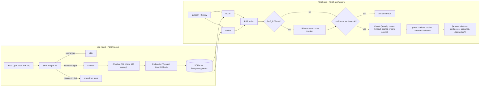

# docs-rag-assistant

A production-shaped **RAG knowledge assistant** over PDF / DOCX / Markdown / text documents:
hybrid retrieval (BM25 + vectors, optional reranker), Claude answers with **page-level
citations** (`[refund_policy.pdf p.2]`), an explicit **abstain** path when the documents do not
contain the answer, a FastAPI service with auth, streaming, rate limiting and structured logs,
SQLite or Postgres+pgvector storage with incremental re-indexing, Docker/compose packaging, CI,
and an offline evaluation harness.

The three documents in `docs/` are fictional fixtures used by the tests and the eval set. Point
`RAG_DOCS_DIR` at your own corpus.

## Architecture



**Request path.** Every request gets an `X-Request-ID` (echoed from the client or generated)
that is bound into every log line via `structlog.contextvars`. Auth, size limit and rate limit
are checked before any work happens. `/ask` abstains *before* calling Claude when retrieval
confidence is under the threshold, so off-topic questions cost no tokens.

**Confidence.** `0.6 * IDF-weighted term coverage + 0.4 * best cosine`, in `[0, 1]`. It is
deliberately simple and explainable; `?debug=true` returns the per-hit scores so you can see why
a question abstained.

**Storage.** Both stores implement the same `ChunkStore` protocol (`rag/store.py`). The hybrid
retriever loads the full chunk matrix into memory at startup because BM25 needs every chunk's
text anyway; this is fine to roughly 10^5 chunks. `PgVectorStore.cosine_search` already does an
ANN query in the database for when the corpus outgrows that (see Limits).

## Modules

```
rag/
  config.py      pydantic-settings Settings (validated at startup; RAG_* env vars)
  logging.py     structlog: JSON lines in prod, console locally, request_id on every line
  ingest.py      loaders, chunking, content_hash()
  embeddings.py  hash / Voyage / OpenAI behind one Protocol; retries, batching, usage logs
  store.py       ChunkStore Protocol, SQLiteStore, get_store()
  store_pg.py    PgVectorStore (psycopg 3 + pgvector)
  retrieval.py   BM25 + cosine + RRF, confidence, RetrievalDiagnostics
  rerank.py      LLMReranker (one Claude call) / CrossEncoderReranker (optional extra)
  answer.py      cite-or-abstain prompt, ClaudeLLM (tenacity, streaming, cost logging)
  service.py     build_index() incremental sync, RagService.ask() / ask_stream()
  api.py         FastAPI app: auth, rate limit, size limit, SSE, /health, /ready, /metrics
  cli.py         rag ingest | ask | serve
  eval.py        python -m rag.eval
```

## Quickstart (local, no keys)

```bash
uv sync --all-groups
cp .env.example .env            # optional; defaults work offline
uv run rag ingest               # SQLite at data/index.sqlite, hash embeddings
uv run rag ask "How many PTO days per year?" --debug
uv run rag serve                # http://127.0.0.1:8000/docs
```

Without `ANTHROPIC_API_KEY` the service answers with an extractive stand-in (best matching
sentence, cited) and logs `extractive_llm_in_use`; without an embedding key it uses hash
embeddings and logs `hash_embeddings_in_use`. Both are for tests and local runs only.

## Deploy

### Docker Compose (API + pgvector)

```bash
cp .env.example .env     # set ANTHROPIC_API_KEY, VOYAGE_API_KEY (or OPENAI_API_KEY), RAG_API_KEY
make up                  # builds the image, starts pgvector/pgvector:pg16 and the API on :8000
curl -X POST -H "X-API-Key: $RAG_API_KEY" localhost:8000/ingest
curl -s -X POST -H "X-API-Key: $RAG_API_KEY" -H 'content-type: application/json' \
     localhost:8000/ask -d '{"question":"What is the refund window?"}'
```

`docker-compose.yml` sets `DATABASE_URL=postgresql://rag:rag@db:5432/rag` and mounts `./docs`
read-only at `/app/docs`. Change the Postgres password for anything beyond a laptop.

### Image only

The `Dockerfile` is multi-stage (uv builder, `python:3.12-slim` runtime), runs as a non-root
`app` user, exposes `8000`, has a `HEALTHCHECK` on `/health`, and uses `/data` as a volume for
the SQLite index when no `DATABASE_URL` is given.

```bash
make docker-build
docker run --rm -p 8000:8000 --env-file .env -v $(pwd)/docs:/app/docs:ro -v rag-data:/data docs-rag-assistant:local
```

### Behind a load balancer

- Use `GET /ready` as the readiness probe (503 until the store answers) and `GET /health` as
  liveness.
- Run several replicas only with Postgres; SQLite is single-writer.
- Rate limits are per process (in-memory); put a shared limit at the edge if you need a global
  one.
- Terminate TLS in front of the service; the API key travels in a header.

## API

| Route | Auth | Purpose |
|---|---|---|
| `GET /health` | no | liveness: version, store type, embedding provider, flags |
| `GET /ready` | no | readiness: pings the store; 503 if it fails; reports chunk count |
| `POST /ingest?full=false` | yes | incremental sync of `RAG_DOCS_DIR`; `full=true` rebuilds |
| `POST /ask?debug=false` | yes | `{question, top_k?, history?}` -> `{answer, citations, confidence, abstained, diagnostics?}` |
| `POST /ask/stream?debug=false` | yes | same input; SSE events `meta`, `delta` (`{"text"}`), `done` (full response) |
| `GET /metrics` | no | Prometheus, only when `RAG_METRICS_ENABLED=true` |

- `history` is a list of `{role: user|assistant, content}`; only the last `RAG_HISTORY_TURNS`
  pairs are forwarded to Claude. Retrieval uses the current question only.
- Errors: `401` bad/missing key, `409` empty index, `413` body too large, `422` validation,
  `429` rate limited (`Retry-After` header), `503` store unavailable.
- The streaming `done` event is authoritative: if the streamed text turns out to be uncited, the
  final payload is `abstained=true` with the abstain phrase as `answer`.

## Configuration

Settings are loaded by `rag/config.py` (pydantic-settings) from the environment and an optional
`.env`; invalid values fail at startup. Credentials are `SecretStr` and never appear in logs.

| Variable | Default | Notes |
|---|---|---|
| `ANTHROPIC_API_KEY` | unset | Claude. Unset = extractive stand-in with warning. |
| `VOYAGE_API_KEY` / `OPENAI_API_KEY` | unset | Embeddings. |
| `RAG_API_KEY` | unset | `X-API-Key` for protected routes. Unset = auth off with warning. |
| `DATABASE_URL` | unset | `postgresql://...` enables pgvector; otherwise SQLite. |
| `RAG_DB_PATH` | `data/index.sqlite` | SQLite file. |
| `RAG_DOCS_DIR` | `docs` | Corpus directory. |
| `RAG_MODEL` | `claude-sonnet-5-5` | Claude model id. |
| `RAG_EMBEDDING_PROVIDER` | `auto` | `auto` = voyage if key, else openai if key, else hash. |
| `RAG_EMBED_BATCH_SIZE` | `64` | Texts per embedding request. |
| `RAG_TOP_K` | `5` | Chunks sent to the LLM (1-50). |
| `RAG_CANDIDATES` | `20` | Fusion pool per retriever. |
| `RAG_CONFIDENCE_THRESHOLD` | `0.30` | Abstain below this. |
| `RAG_RERANK` | `false` | Enable second-stage reranking. |
| `RAG_RERANKER` | `llm` | `llm` or `cross-encoder` (`uv sync --extra rerank`). |
| `RAG_RERANK_CANDIDATES` | `20` | Pool fed to the reranker. |
| `RAG_CROSS_ENCODER_MODEL` | `cross-encoder/ms-marco-MiniLM-L-6-v2` | |
| `RAG_CHUNK_SIZE` / `RAG_CHUNK_OVERLAP` | `700` / `120` | Characters; overlap must be smaller. |
| `RAG_HISTORY_TURNS` | `6` | Conversation pairs forwarded; `0` disables. |
| `RAG_MAX_REQUEST_BYTES` | `64000` | 413 above this. |
| `RAG_RATE_LIMIT` | `60/minute` | slowapi syntax, keyed by API key or IP. |
| `RAG_METRICS_ENABLED` | `false` | `/metrics` (`uv sync --extra metrics`). |
| `RAG_HOST` / `RAG_PORT` | `127.0.0.1` / `8000` | |
| `RAG_LLM_TIMEOUT_SECONDS` / `RAG_LLM_MAX_RETRIES` / `RAG_LLM_MAX_TOKENS` | `60` / `3` / `1024` | Retries cover 429, 5xx, timeouts and connection errors with exponential backoff. |
| `RAG_EMBED_TIMEOUT_SECONDS` / `RAG_EMBED_MAX_RETRIES` | `30` / `3` | |
| `RAG_LOG_JSON` / `RAG_LOG_LEVEL` | `true` / `INFO` | |

## Runbook

**Re-index after documents change.** `make ingest` (or `POST /ingest`). Each file is hashed;
unchanged files are skipped, changed files are re-chunked and re-embedded, files removed from
the directory are pruned. The response lists `indexed`, `skipped`, `pruned` and `failed`
(a document that fails to parse is logged as `document_failed` and skipped; it never aborts the
run). The CLI exits 1 if anything failed so cron jobs notice.

**Full rebuild.** `make ingest-full` / `POST /ingest?full=true`. Also happens automatically when
the configured embedding provider differs from the one the index was built with (different
vector spaces must not be mixed).

**Change embedding provider or model.** Set the key / `RAG_EMBEDDING_PROVIDER`, restart, run a
full ingest. Changing `RAG_MODEL` needs only a restart.

**Rotate keys.**
- Provider keys (`ANTHROPIC_API_KEY`, `VOYAGE_API_KEY`, `OPENAI_API_KEY`): update the secret,
  restart the service. There is no cached client state to flush.
- `RAG_API_KEY`: the service accepts exactly one key. For zero-downtime rotation run two
  replicas behind the balancer with old and new keys, switch clients, then retire the old one.

**Tune the abstention threshold.** Run `make eval` (or `python -m rag.eval`) against
`evals/questions.jsonl` extended with your own labelled questions. Lower the threshold if
`answerable -> abstained` is high; raise it if unanswerable questions get answered. Use
`POST /ask?debug=true` on a failing question to see `confidence` next to each hit's
`vector` / `bm25` / `fused` score. With real embeddings the gap between on- and off-topic
questions is much wider than with hash embeddings, so retune after switching provider.

**"It didn't find my PDF".** Check `/ready` for the chunk count, grep logs for
`document_failed` and the document name, then `ask --debug` to see which chunk ids were
retrieved (`chunk_ids` is logged on every `ask`).

**Costs.** Every Claude call logs `llm_usage` with input/output tokens and an estimated USD
cost (`MODEL_PRICES` in `rag/answer.py`); embedding calls log `embedding_usage`. The system
prompt is sent with `cache_control` so repeated questions hit the prompt cache.

## Evaluation

`evals/questions.jsonl` has 17 labelled questions: 14 answerable (expected document, page and
keywords; several paraphrased) and 3 unanswerable. `make eval` rebuilds the index into the
configured store and prints per-question results plus:

| Metric | Offline (hash embeddings, extractive stand-in) |
|---|---|
| Retrieval hit@5 | 100% (14/14) |
| Citation accuracy | 93% (13/14) |
| Keyword accuracy | 86% (12/14) |
| Unanswerable abstained | 100% (3/3) |
| Answerable wrongly abstained | 0% (0/14) |

These numbers are from the **offline** path only. No `ANTHROPIC_API_KEY` or embedding key was
available when this version was built, so there are no live Claude / Voyage numbers here. Set
the keys and run `make eval` to measure the real stack; expect the abstention margin to widen
(the "Who is the CEO?" question scores 0.29 against the 0.30 threshold on hash embeddings).

## Development

```bash
make lint      # ruff check + ruff format --check
make test      # pytest with coverage, fails under 80%
make eval
```

Tests are fully offline: the LLM is a scripted fake, embeddings are hash-based, Claude SDK
errors are constructed locally to exercise the retry path. The pgvector store has a fake-
connection test for its SQL wiring and a live contract test that runs only when
`TEST_DATABASE_URL` points at a Postgres with the `vector` extension (marker `pg`).

CI (`.github/workflows/ci.yml`) runs ruff, the test suite with the coverage gate, and a Docker
build on every push and pull request.

## Limits and decisions

- **In-memory retrieval.** The full chunk matrix is loaded per process; for corpora beyond
  ~10^5 chunks switch the vector leg to `PgVectorStore.cosine_search` and a Postgres full-text
  index for BM25. Reload happens on `/ingest` in the serving process; other replicas pick up
  changes on restart.
- **Rate limiting is per process** (slowapi in-memory storage). Use edge limiting for a global
  budget.
- **One API key.** Enough for service-to-service use; multi-tenant deployments need a key table.
- **PDF extraction** is pypdf text only: no OCR, no layout-aware tables.
- **Reranker.** The default `llm` reranker costs one extra Claude call per question; the
  cross-encoder runs locally but pulls in sentence-transformers/torch, so it is an optional
  extra and not exercised in CI.
- **Model.** Kept at `claude-sonnet-5-5` for latency/cost; set `RAG_MODEL` to an Opus model for
  harder corpora.
- **Hash embeddings** exist so the whole pipeline is testable with no keys. They are not
  semantic; the service warns at startup when they are in use.

## License

MIT
